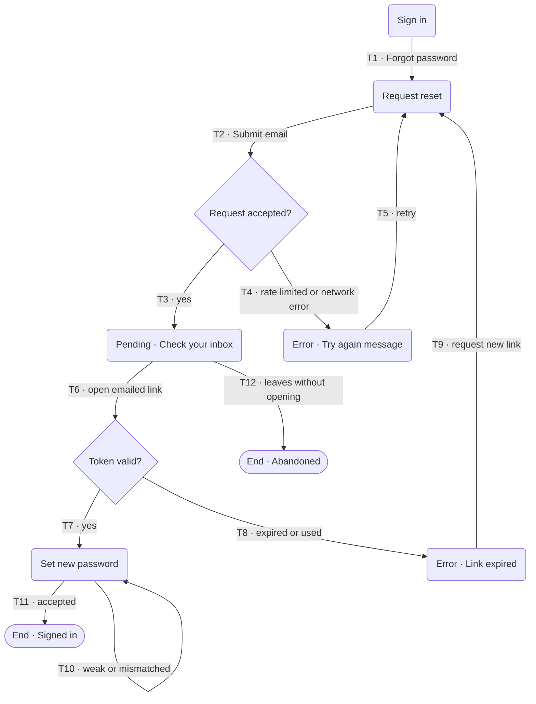
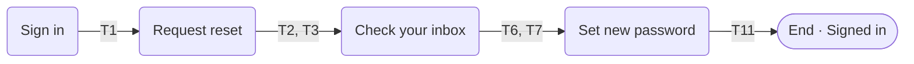
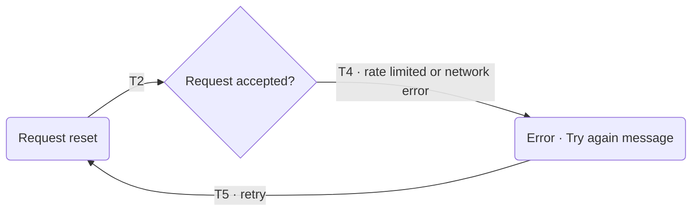
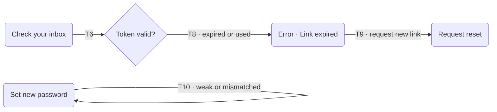
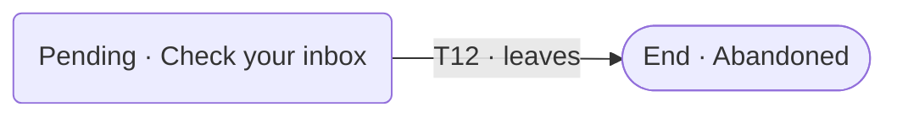

# Example: user-flow-designer

> **Illustrative example.** All inputs and outputs below use invented sample data to show the output shape. The project, routes, and findings are hypothetical.

## Prompt

```
/user-flow-designer Password reset for the web app. Routes are in src/routes.tsx.
```

## Sample input (invented)

`src/routes.tsx` lists `/sign-in`, `/forgot-password`, and `/reset-password/:token`. There is no screen for an expired link and no flow doc.

## What the skill does

1. Reads `src/routes.tsx` and the existing auth screens, and lists them as sources.
2. Traces the task before drawing: entry points, decisions, errors, retries, and end states.
3. Builds the transition inventory, draws one complete diagram with one labeled arrow per row, then one diagram per individual flow.
4. Records what the sources do not settle, runs the integrity check, and tags backend behavior it cannot see.

## Output shape (`design/journeys/user-flow-password-reset-<YYYY-MM-DD>.md`)

````markdown
> skill: user-flow-designer · date: <YYYY-MM-DD> · scope: password reset · sources: src/routes.tsx (hypothetical)

## Task, actors, entry and exit states
- Actor: a signed-out user who cannot sign in. No other actor moves this task.
- Entry points and intent: `/sign-in` "Forgot password" (sign-in just failed); `/forgot-password` opened directly (already knows); emailed link to `/reset-password/:token` (resuming).
- Ends: signed in with a new password; abandoned at any step; link expired and not renewed.

## Evidence base
- src/routes.tsx, date unknown: lists `/sign-in`, `/forgot-password`, `/reset-password/:token`. No screen for an expired link.
- No tests, specification, or earlier flow doc found.

## Complete flow

| Shape and text | Meaning |
|---|---|
| Rounded box | Screen or state |
| Diamond | Decision; every outgoing edge is labeled |
| Stadium, `End ·` | Terminal state |
| `Error ·`, `Pending ·` prefix | Error or waiting state |

## Transition inventory
| ID | From | Trigger | Condition | To | Feedback | Status | Evidence |
|---|---|---|---|---|---|---|---|
| T1 | Sign in | Tap Forgot password | none | Request reset | Request screen | Verified | src/routes.tsx |
| T3 | Request accepted? | Response | accepted | Check your inbox | Same message whether or not the account exists | Inferred | no API read |
| T8 | Token valid? | Open link | expired or used | Link expired | Expired message | Unknown | no expired screen in routes |
| T11 | Set new password | Submit | accepted | Signed in | Home | Inferred | auto sign-in not confirmed |

(Rows T2, T4 to T7, T9, T10, T12 follow the same pattern.)

## Individual flows
### F1 · Primary journey: reset and sign in
Purpose: the common path. Actor: signed-out user. Ends: signed in.

4 steps. Candidate: show the inbox message inline on Request reset and drop a screen.

### F2 · Request fails and is retried
Purpose: recovery from a rejected request. Actor: signed-out user. Ends: back on Request reset.


### F3 · Expired link and weak password loops
Purpose: recovery after the email step. Actor: signed-out user. Ends: back on Request reset, or still on Set new password.


### F4 · Abandon
Purpose: the user leaves before using the link. Actor: signed-out user. Ends: abandoned.


## Screen state table
| Screen | Empty | Loading | Partial | Error | Success | Permission denied |
|---|---|---|---|---|---|---|
| Request reset | Button disabled `[inferred]` | Spinner `[inferred]` | Email typed, invalid | Invalid format; rate limit; network | Moves to inbox | Not applicable |
| Set new password | Both fields empty | Spinner | Strength shown | Weak; mismatch; token rejected | Signed in | Not applicable |

## Gaps, contradictions, and unknowns
- Missing: no expired-link screen in the routes, though T8 needs one.
- Unknown: token lifetime and single use; whether the API reveals that an account exists.

## Flow integrity check
- One complete diagram: 10 nodes, 12 edges, 12 inventory rows (8 of them elided in this example); edges and rows match by ID.
- Individual flows F1 to F4 together cover T1 to T12.
- Every entry reaches an end state; no unreachable nodes; both decisions have two labeled branches.
- Status: 2 Verified, 8 Inferred, 2 Unknown. Not compared: tests (none found) and the API.

## Open questions / to validate
- What is the token lifetime, and is it single use?
- Should signing in happen automatically after reset?

## Next step
Run `design-documentation` once the flow is approved.
````
