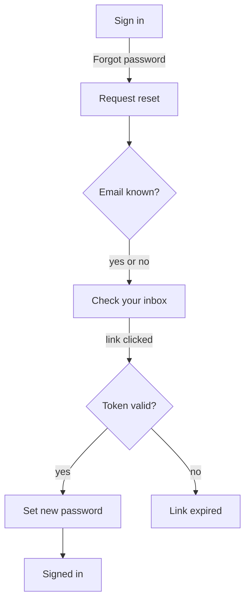

# Example: user-flow-designer

## Prompt

```
/user-flow-designer Password reset for the web app. Routes are in src/routes.tsx.
```

## What the skill does

1. Reads `src/routes.tsx` and existing auth screens.
2. Defines start state (logged out, on sign-in) and end states (signed in; abandoned; locked).
3. Draws happy path, adds error paths, fills state table.

## Output shape (`design/journeys/user-flow-password-reset-2026-11-01.md`)

```markdown
> skill: user-flow-designer · date: 2026-11-01 · scope: password reset · sources: src/routes.tsx, src/pages/auth/*

## Flow diagram (Mermaid)


## Screen state table
| Screen | Empty | Loading | Error | Success |
|---|---|---|---|---|
| Request reset | field empty, CTA disabled | spinner on CTA | invalid email format | redirects to D |
| Set new password | both fields empty | spinner | mismatch, weak password | redirects to H |

## Data and permission notes
- Token TTL unknown [assumption]; confirm with backend.

## Step count and simplification candidates
Happy path: 5 screens. Candidate: skip D by showing inline confirmation on B.

## Open questions / to validate
- Does the API reveal whether an email exists? Affects C.

## Next step
Run `design-documentation` once the flow is approved.
```
