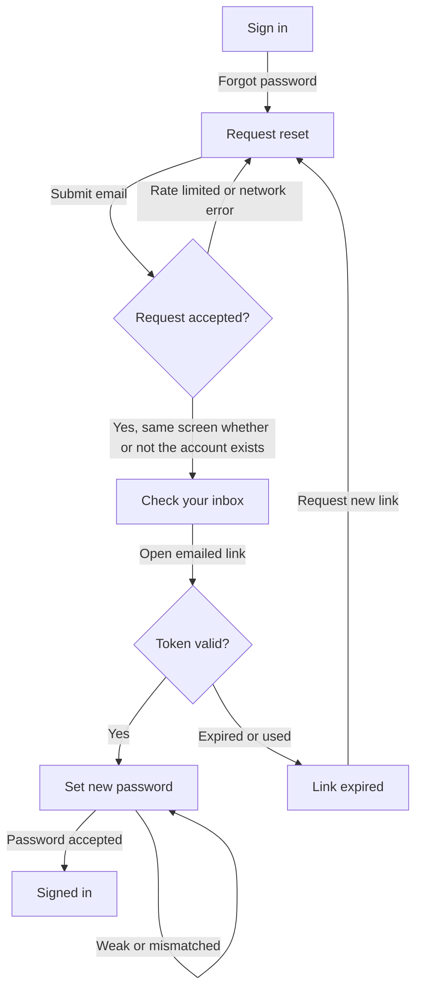

# Example: user-flow-designer

> **Illustrative example.** All inputs and outputs below use invented sample data to show the output shape. The project, routes, and findings are hypothetical.

## Prompt

```
/user-flow-designer Password reset for the web app. Routes are in src/routes.tsx.
```

## Sample input (invented)

`src/routes.tsx` lists `/sign-in`, `/forgot-password`, and `/reset-password/:token`. There is no screen for an expired link and no flow doc.

## What the skill does

1. Reads `src/routes.tsx` and existing auth screens.
2. Defines the start state and the success and failure end states.
3. Draws the happy path, then error paths, then fills the state table.
4. Tags backend behavior it cannot see as `[assumption]`.

## Output shape (`design/journeys/user-flow-password-reset-<YYYY-MM-DD>.md`)

````markdown
> skill: user-flow-designer · date: <YYYY-MM-DD> · scope: password reset · sources: src/routes.tsx (hypothetical)

## Task, actor, entry and exit states
- Actor: a signed-out user who cannot sign in [assumption: no other actors considered].
- Entry points and intent:
  - `/sign-in` via a "Forgot password" link: the user tried to sign in and failed [observed: src/routes.tsx; link text is an assumption].
  - `/forgot-password` opened directly, for example from a bookmark: the user already knows they need a reset [inferred: the route exists on its own].
  - An emailed link to `/reset-password/:token`: the user requested a reset earlier and is resuming [observed: src/routes.tsx].
- Success exit: signed in with a new password.
- Failure exits: abandoned at any step; link expired and not renewed.

## Flow diagram (Mermaid or list)


## Alternate and error paths
- Invalid email format: stays on B with an inline error.
- Rate limit or network error: stays on B with a retry message.
- Expired or used link: G, with a path back to B. No such screen exists in the routes [observed: src/routes.tsx].
- Back navigation from D returns to B with the email kept.
- Abandonment after D: the link stays valid until it expires [assumption].

## Screen state table
| Screen | Empty | Loading | Partial | Error | Success |
|---|---|---|---|---|---|
| B Request reset | Email empty, button disabled | Spinner on button | Email typed, not valid | Invalid format; rate limit; network | Moves to D |
| D Check your inbox | Not applicable | Not applicable | Resend available after a delay [assumption] | Resend failed | Not applicable |
| F Set new password | Both fields empty | Spinner on button | Fields filled, strength shown | Weak password; mismatch; token rejected | Moves to H |
| G Link expired | Not applicable | Not applicable | Not applicable | Not applicable | "Request new link" moves to B |

No screen in this flow is gated by a permission, so there is no permission-denied column [inferred: all routes are reachable signed out].

## Data and permission notes
- Token lifetime and single use: unknown [assumption]; confirm with the backend owner.
- Whether the API reveals if an email has an account: unknown. The diagram assumes it does not [assumption].

## Step count and simplification candidates
Happy path: 5 screens (A, B, D, F, H). Candidate: after sending, show the inbox message inline on B and drop D.

## Open questions / to validate
- What is the token lifetime, and is it single use?
- Is rate limiting enforced server side?
- Should signing in happen automatically after reset?

## Next step
Run `design-documentation` once the flow is approved.
````
